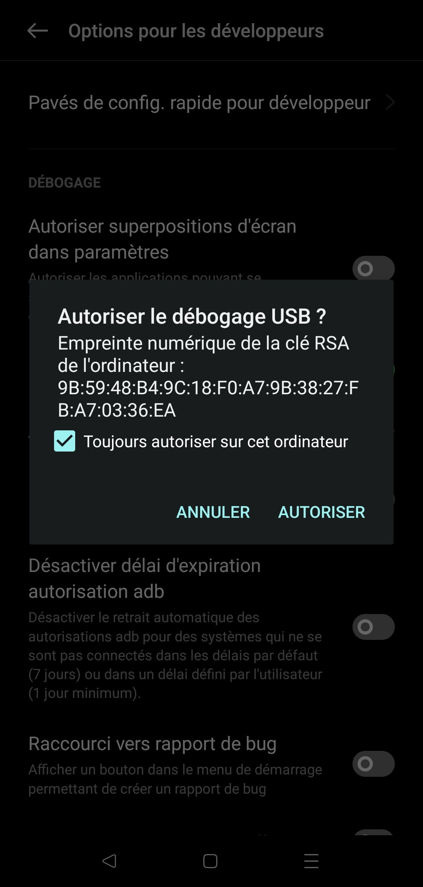
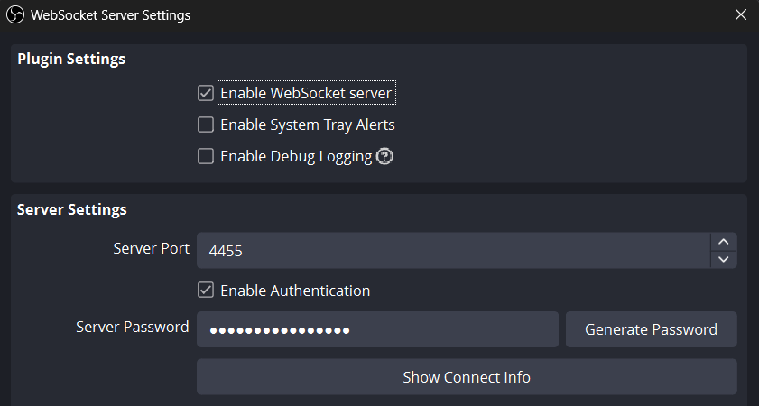

# obs-phonecast

**Show an Android app on stream, in OBS, with no notifications and no navigation bar.**
Not a webcam. Not a screen-recording hack. A clean, dedicated virtual display that OBS captures as a normal source.

```
obs-phonecast --app youtube
```

Built on [scrcpy](https://github.com/Genymobile/scrcpy)'s virtual display and obs-websocket. Works on Windows, macOS and Linux, over USB or Wi-Fi.

> Looking for your phone's **camera** as a webcam (DroidCam, Iriun, scrcpy `--video-source=camera`)? That's a different problem. obs-phonecast is for showing your phone's **screen / apps**.

---

## The problem this solves

Mirroring a phone's screen into OBS is easy. Doing it **cleanly** is not:

- notifications show up live in front of your viewers
- the nav bar and status bar clutter the frame
- you have to recreate and reposition the source every session

obs-phonecast uses scrcpy's **virtual display**: the phone creates a second display, invisible on its physical screen, where only the chosen application runs. Notifications stay on the phone's real screen and never reach the stream. There's no status bar and no nav bar, because they don't exist on that display.

obs-phonecast then creates and configures the source in OBS for you, via obs-websocket.

## How is this different from...

| | What it does | Notifications on stream? | Sets up OBS for you? |
|---|---|---|---|
| Phone as webcam (DroidCam, Iriun...) | Streams the phone's **camera** | n/a | No |
| Plain scrcpy + window capture | Mirrors the physical screen | **Yes**, plus status bar and nav bar | No |
| [scrcpy-camera](https://github.com/NanKillBro/scrcpy-camera) (OBS plugin) | Captures the screen or camera through an OBS plugin | Depends on mode | Plugin |
| **obs-phonecast** | Runs one app on a hidden virtual display | **No** | **Yes**: scene, source, position kept between sessions |


## Requirements

| | |
|---|---|
| Phone | Android 11+ (virtual display), Android 5 minimum (mirror mode) |
| PC | Windows, macOS, or Linux |
| OBS | version 28+ (obs-websocket is built in) |
| Node.js | version 20+ |
| scrcpy | version 3.0+ |

## Installation

```bash
git clone https://github.com/EnzoGrn/obs-phonecast
cd obs-phonecast
npm install
npm link # makes the `obs-phonecast` command available globally
```

You'll also need scrcpy:

- **Windows** -- download the release from [github.com/Genymobile/scrcpy](https://github.com/Genymobile/scrcpy/releases), unzip, add the folder to `PATH`. Nothing else to install, adb is included.
- **macOS** -- `brew install scrcpy`
- **Linux** -- `apt install scrcpy`, `pacman -S scrcpy`, depending on your distro

obs-phonecast finds it on the `PATH` automatically. You can force a specific path with the `OBS_PHONECAST_SCRCPY` variable.

## Quick start

### 1. Enable USB debugging on the phone

Settings > About phone > tap "Build number" seven times, then Settings > Developer options > USB debugging.

Plug in the cable. A prompt appears **on the phone**:



Check "Always allow from this computer" and accept. This is by far the most common sticking point: if you see nothing, check that the phone is set to "File transfer" mode, not "Charging only".

### 2. Enable OBS's WebSocket server

In OBS: Tools > WebSocket Server Settings. Check "Enable WebSocket server", then click "Show Connect Info" to get the generated password.



You don't make it up, OBS generates it. Save it once and for all in your config file (see below), or pass it via the `OBS_PHONECAST_PASSWORD` variable.

If you uncheck "Enable Authentication", leave this blank: the connection will proceed without a password. That's acceptable on a machine you're the only one with network access to, but keep in mind the server listens on all interfaces by default -- without a password, anyone on the same Wi-Fi can control your OBS.

### 3. Launch

```bash
node src/index.js --list-apps        # find your application's name
node src/index.js --app youtube      # start
```

The "Phone" scene and "Phone Screen" source are created and positioned automatically. Ctrl+C to stop.

### Prefer not to use a terminal at all?

`obs-phonecast --dock` starts a web panel instead (app picker, on-air-style start/stop, live log feed, settings) that you add in OBS via Docks → Custom Browser Docks. It opens your default browser automatically so you immediately see it's working. See [Usage](#usage) below for the rest of what it can do.

To avoid typing that command at all, `launchers/obs-phonecast-autostart.lua` starts the dock automatically when OBS itself launches, and stops it when OBS closes. Add it once via OBS's own **Tools → Scripts → +**, nothing to install separately (OBS bundles Lua). Still requires `npm install -g obs-phonecast` first. See the file's own header comment for exact status and troubleshooting -- it's reasoned through and unit-tested in isolation, but not yet verified against a real OBS install.

## The dock (`--dock`)

```bash
obs-phonecast --dock
```

Starts a local web panel: app picker, start/stop button, live log feed, and a settings form that reads and writes the same config file as `--init`. It opens in your default browser (`--no-open` to skip that) and prints its URL, `http://127.0.0.1:7412` by default (`--dock-port` to change the port).

**Adding it to OBS:** Docks > Custom Browser Docks, give it a name, paste that URL, Apply. The dock then lives inside OBS next to your scenes. Leave the `obs-phonecast --dock` process running (or use the Lua launcher above).

While a session starts the button reads "Starting..." and is disabled; it turns into "Stop" once the stream is up.

**Security.** The dock can start and stop a live session and can read or overwrite your OBS WebSocket password. So:

- it binds to `127.0.0.1` only, so nothing else on your network can reach it;
- it refuses WebSocket connections from other web pages (Origin check) and from unexpected host names (Host check, against DNS rebinding);
- the config file it writes is private to your user (`0600` on macOS/Linux).

**`--dock-host <addr>`** binds to another address, to drive the dock from a phone or another PC on your LAN, for example `--dock-host 192.168.1.20` and then open `http://192.168.1.20:7412` there. `0.0.0.0` (all interfaces) works too; in that case only requests addressed by IP are accepted, not by name. This is an explicit opt-in and logs a warning: anyone who can reach that address can control your session and read your OBS password, so only do it on a network you trust. There is no authentication.

## Usage

```bash
# Partial name accepted, accents ignored
obs-phonecast --app instagram

# Bigger, for viewers on mobile
obs-phonecast --app tiktok --dpi 440

# Wider display, more generous bitrate
obs-phonecast --app "google maps" --size 1200x2000 --bitrate 20M

# Also capture the phone's audio (Android 11+)
obs-phonecast --app spotify --audio

# Allow clicking in the app from the PC
obs-phonecast --app youtube --control
```

`--help` lists every option.

**Control.** `--app` and `--launcher` turn mouse/keyboard control on automatically: scrcpy cannot start an app, or let you use a launcher, with control disabled. Without either you get a read-only mirror. `--control` forces it on explicitly.

### Configuration file

The easiest way to get one:

```bash
obs-phonecast --init
```

Asks for the OBS WebSocket password and a default app, then writes the file. Won't touch an existing file unless you pass `--force` too.

So you don't have to retype anything. Location:

| OS | Path |
|---|---|
| Windows | `%APPDATA%\obs-phonecast\obs-phonecast.json` |
| macOS | `~/.config/obs-phonecast/obs-phonecast.json` |
| Linux | `$XDG_CONFIG_HOME/obs-phonecast/obs-phonecast.json` or `~/.config/obs-phonecast/` |

```json
{
  "app": "com.google.android.youtube",
  "display": { "width": 1080, "height": 2000, "dpi": 420 },
  "video": { "bitrate": "16M", "maxFps": 60 },
  "obs": {
    "password": "YOUR_PASSWORD",
    "sceneName": "Phone",
    "inputName": "Phone Screen"
  },
  "layout": { "anchor": "right", "widthRatio": 0.28, "marginPx": 24 }
}
```

Priority: command-line arguments, then environment variables, then this file, then the defaults.

## The settings that actually matter

**`--dpi`** is the most underrated one. It controls the **size** of UI elements, not sharpness. A low DPI packs a lot of content in very small text, unreadable for a viewer watching you on their own phone. For streaming you generally want things bigger than on a real phone: start at 420 and go up if needed.

**`--bitrate`** defaults to 16M, while scrcpy's own default is 8M. The transport is local (USB or your network), so bandwidth is essentially free, and OBS is going to **re-encode** your image anyway -- better to feed it a clean source. A too-low bitrate shows up mostly on fast scrolling, exactly what happens when you're navigating an app.

**`--encoder`** is your fallback. A phone often has several hardware encoders, and some produce artifacts. If the image looks off, list them with `scrcpy --list-encoders` and try a different one. This fixes the majority of "it doesn't work well on my phone" reports.

**`--extend-screen-timeout` is OFF by default.** It was originally meant to work around a documented scrcpy issue ([#6787](https://github.com/Genymobile/scrcpy/issues/6787)) where the virtual display goes black 10 seconds after the physical screen turns off, by extending the phone's sleep timeout for the session (restored on exit). **Heads up**: on at least one tested device, this mechanism fails silently (some ROMs, including ColorOS, refuse to let `adb shell` write system settings), and in any case it did not fix a similar-looking disconnect observed even with the screen timeout already disabled manually -- the exact root cause of that kind of disconnect on that device turned out to be unrelated (an OBS scene-creation timing issue, already fixed -- see [ROADMAP.md](ROADMAP.md) for the full story). Pass `--extend-screen-timeout` if you want to try it anyway on a different device.

## Troubleshooting

**obs-phonecast falls back to mirror mode on the very first launch, but holds in virtual-display mode on later launches** -- expected, not a persistent bug. On the first launch, OBS has to create the scene and the source from scratch, which takes noticeably longer than once both already exist. obs-phonecast detects this case and automatically extends the wait time, but on a particularly slow machine that extra margin (10s) might not be enough. Just launch it a second time: the scene and source will already exist, and virtual-display mode should come up in time.

**"Device not authorized"** -- check the phone's screen, the authorization dialog is waiting. See step 1.

**"Could not connect to ws://localhost:4455"** -- OBS isn't running, or the WebSocket server isn't enabled. See step 2.

**"WebSocket password rejected"** -- copy it from OBS, it can't be guessed.

**obs-phonecast falls back to mirror mode** -- your phone's ROM is blocking the virtual display. Some manufacturers do this, and there's no reliable way to detect it ahead of time: obs-phonecast tries, then automatically falls back to mirroring the real screen with the nav bar cropped out. If the crop is off, adjust `navBarHeight` in your config.

**Black image** -- the application is DRM-protected (Netflix, Prime Video, and the like). Nothing to do, that's intentional on the app's part.

**Source stuck at 0x0** -- the scrcpy window might be minimized. On Windows, obs-phonecast forces Windows Graphics Capture, which doesn't need the window to be in the foreground, but it does need to exist.

**Wayland session on Linux** -- automatic scene setup is impossible: the xdg portal forces a dialog where you pick the window by hand. This isn't a limitation of OBS but a security decision baked into the protocol. Use `--v4l2 /dev/video2` (requires the `v4l2loopback` kernel module) or an X11 session.

## Compatibility

| Platform | Capture | Automatic setup |
|---|---|---|
| Windows | Window Capture (WGC) | yes |
| macOS | Screen Capture, window mode | yes |
| Linux X11 | XComposite | yes |
| Linux Wayland | PipeWire portal | no -- use `--v4l2` |

## Development

```bash
npm test          # 202 tests in 16 files, no hardware required (2 are skipped on Windows)
npm start -- --app youtube
```

### Structure

```
obs-phonecast/
├── src/
│   ├── index.js            CLI: parses arguments, builds the logger
│   ├── orchestrator.js     the full sequence, mirror-mode fallback, watchdog
│   ├── config.js           merges CLI > environment > file > defaults
│   ├── settings.js         raw read/write of the config file (0600, atomic), validation
│   ├── init.js             --init: interactive first-run setup
│   ├── prompt.js           readline wrapper used by --init (TTY and piped)
│   ├── errors.js           PhonecastError + codes: user-facing error vs bug
│   ├── fatal.js            uncaughtException / unhandledRejection handlers
│   ├── logger.js           levels + replaceable sink
│   ├── paths.js            config and cache locations, per OS
│   │
│   ├── adb/
│   │   └── index.js        devices, states, properties, wireless
│   │
│   ├── scrcpy/
│   │   ├── args.js         PURE: config -> string[]
│   │   ├── app-list.js     PURE: app-name parsing and resolution
│   │   ├── apps.js         calls --list-apps + disk cache
│   │   ├── binary.js       locating scrcpy and adb
│   │   └── process.js      spawn, monitoring, clean shutdown, Ctrl+C cleanup
│   │
│   ├── obs/
│   │   ├── client.js       websocket connection
│   │   ├── scene.js        the 7 steps of scene creation
│   │   └── platform.js     inputKind and settings per OS
│   │
│   └── server/             the dock's backend (--dock)
│       ├── index.js        HTTP + WebSocket server, Origin/Host checks
│       └── bridge.js       dock <-> orchestrator: one session, start/stop state
│
├── web/
│   └── index.html          the dock's single-page UI
├── launchers/
│   └── obs-phonecast-autostart.lua   OBS script that starts the dock with OBS
├── scripts/
│   ├── embed-dock.js       embeds web/index.html for compiled binaries
│   └── diag-spawn.js       isolated scrcpy spawn repro (debugging aid)
└── test/                   16 files, no hardware required
```

### Three rules to follow if you contribute

**Pure modules stay pure.** `args.js` and `app-list.js` have no side effects and no external dependencies. They're testable without a phone, without OBS, and without `npm install`. This is what makes the logic verifiable -- and it's already caused one split: `apps.js` used to import execa at load time, which made its parsing untestable, hence the extraction of `app-list.js`.

**No `process.platform` outside `src/obs/platform.js`** for the OBS-facing part. The name of the property that holds the window differs by OS, the macOS value changes on every launch, and the SDL class has already changed once. All of that needs to stay in a single file.

**Never build the window identifier yourself.** Ask OBS for the list and take the value as-is. That's what makes the code immune to format changes.

### Logging

`logger.js` exposes levels and a replaceable sink. Redirecting logs elsewhere (the future web dock) is done with `setSink`, without touching any callers. `-v` shows raw scrcpy lines, `-q` leaves only errors. Everything goes to stderr so stdout stays redirectable.

Deferred ideas and rejected decisions are in [ROADMAP.md](ROADMAP.md).

## Credits

All the capture technology comes from **[scrcpy](https://github.com/Genymobile/scrcpy)**, licensed under Apache 2.0.

> Copyright (C) 2018 Genymobile
> Copyright (C) 2018-2026 Romain Vimont

obs-phonecast is only an orchestration layer on top: it never touches a single pixel. If you find this tool useful, [support rom1v's work](https://github.com/sponsors/rom1v).

## License

See [LICENSE](LICENSE): MIT for obs-phonecast's own code. Any scrcpy binaries distributed under `vendor/` remain under Apache 2.0, with their original `LICENSE` file.